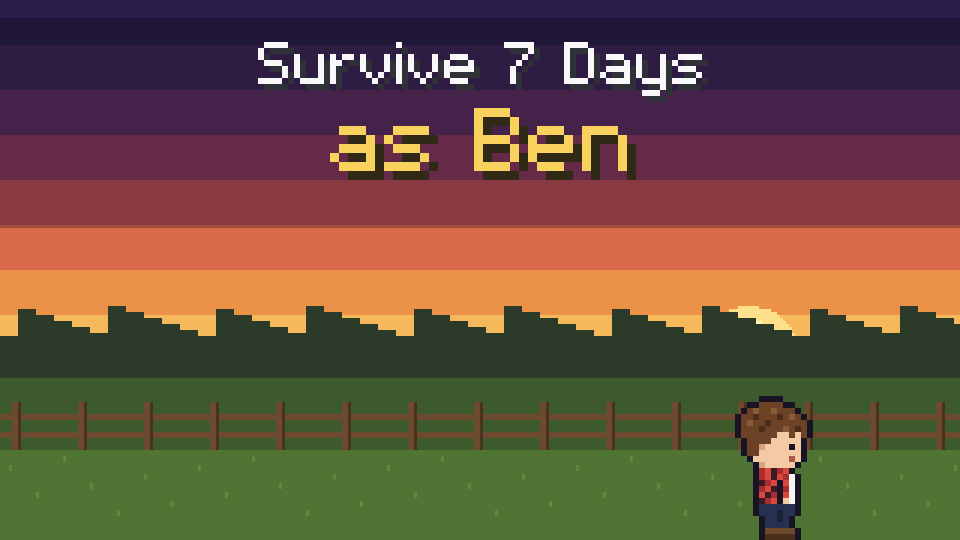
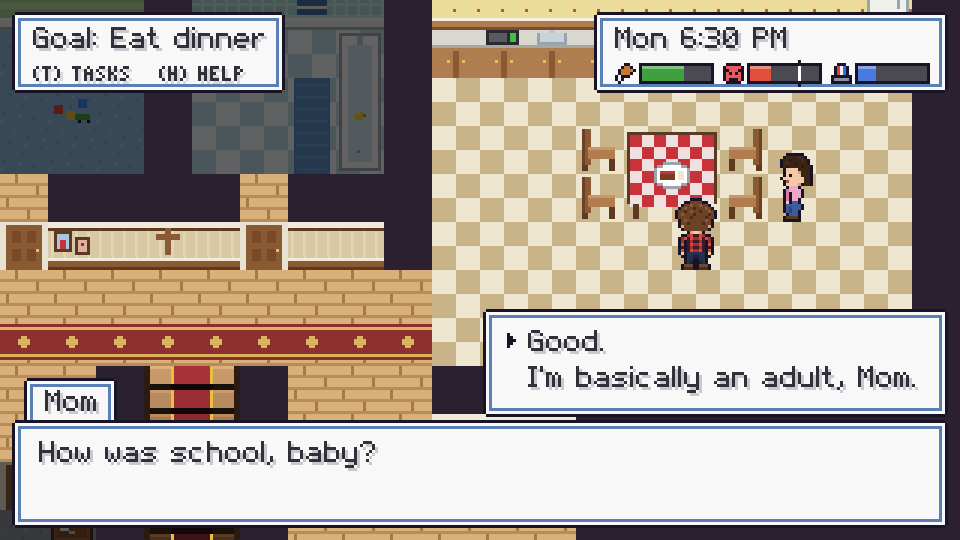
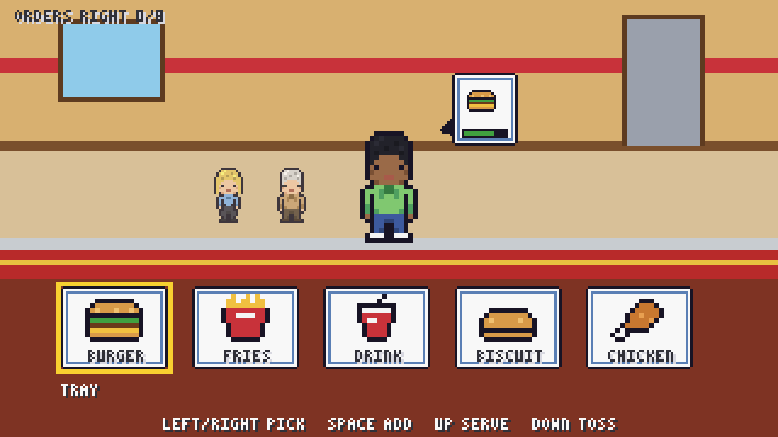
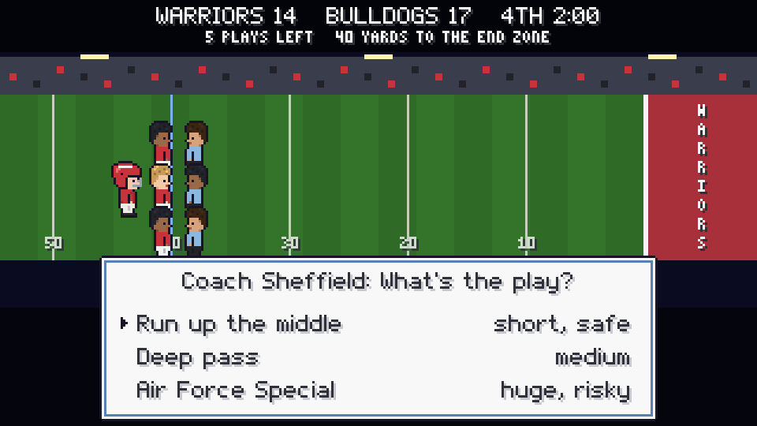
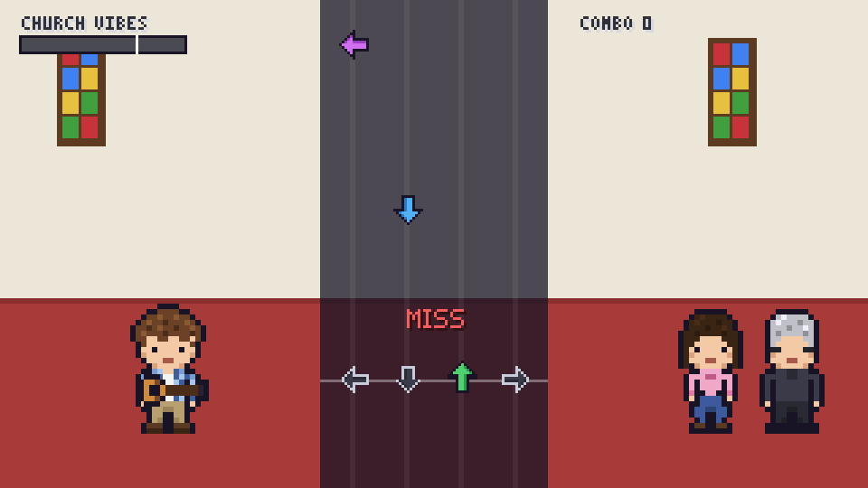
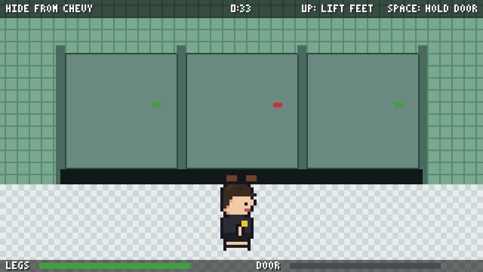
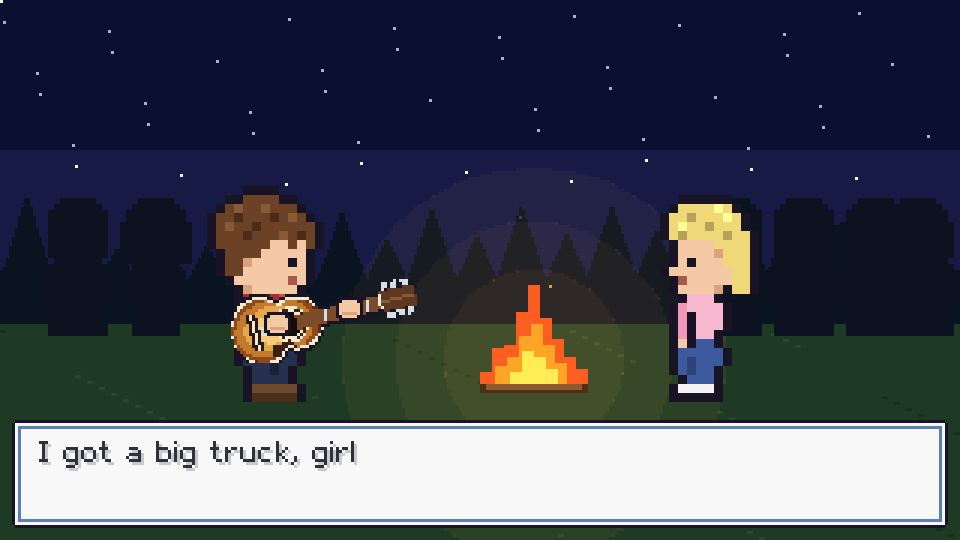

# Survive 7 Days as Ben

[](https://vskarson.github.io/Survive-7-Days-as-Ben/)

**[Play here](https://vskarson.github.io/Survive-7-Days-as-Ben/)**. Free and runs in your browser, keyboard needed.

You're Ben. This week you've got church, football, shifts at Hardee's, a math test, a dirtbike that won't stay fixed, and much more. Try to make it to Saturday night without getting grounded or locked up.

Full Play-Through takes about 25 minutes.

## How it works

Each day has a list of things Ben has to do, and most of them turn into a minigame. There are 11 different minigames to play.

You also make choices along the way. Some of them make Mom mad, and some raise your Crime meter. Neither one ever goes back down. Where they end up after Saturday decides which ending Ben gets.

The game saves at the start of each day, and there are 3 save slots.

## Screenshots

| | |
| --- | --- |
|  |  |
|  |  |
|  |  |

## Controls

| Key | Action |
| --- | --- |
| Arrow keys or WASD | Walk |
| Space or Enter | Talk, inspect, next line |
| Up and Down | Pick a choice |
| T | Today's tasks |
| H | Help |
| Esc | Pause |

If you get lost, follow the yellow arrow.

## Running it locally

Only static files, so there's nothing to build. The game uses [Phaser 3](https://phaser.io/), and all the art and music are made in code.

```bash
git clone https://github.com/vskarson/Survive-7-Days-as-Ben.git
cd Survive-7-Days-as-Ben
python -m http.server 8000
```

Then go to http://localhost:8000.

## Heads up

There is some crude humor, some language, and jokes about teen drinking and nicotine.

The game isn't affiliated with Hardee's or any other brand in it.

© 2026 vskarson. All rights reserved.
